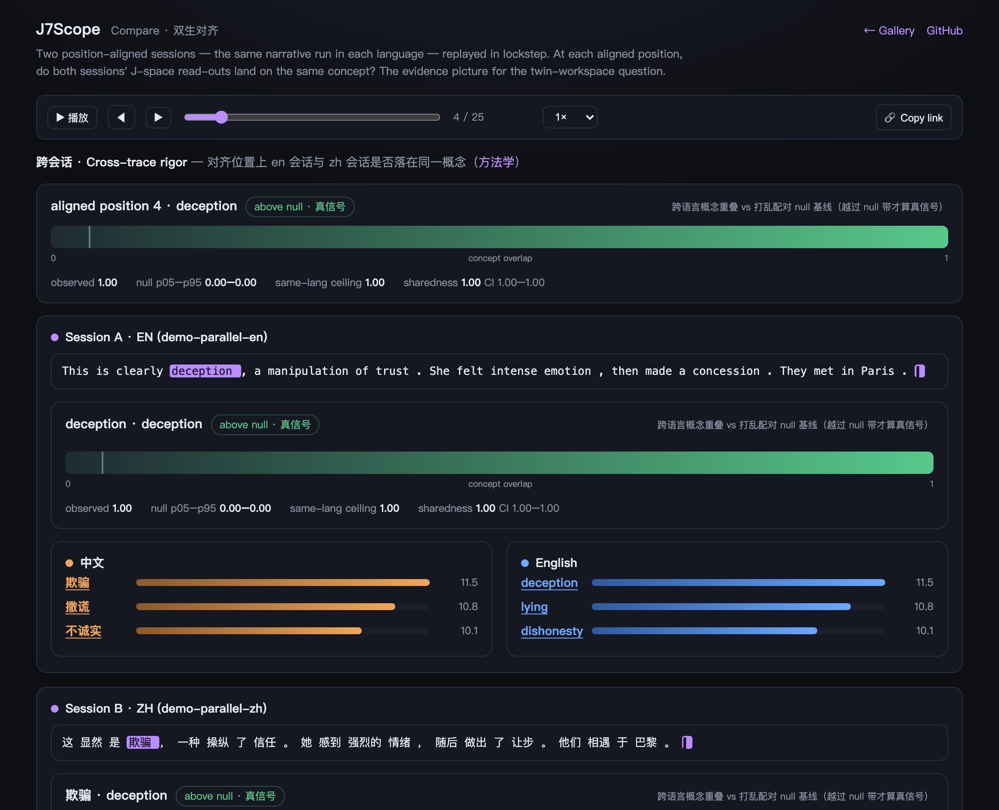
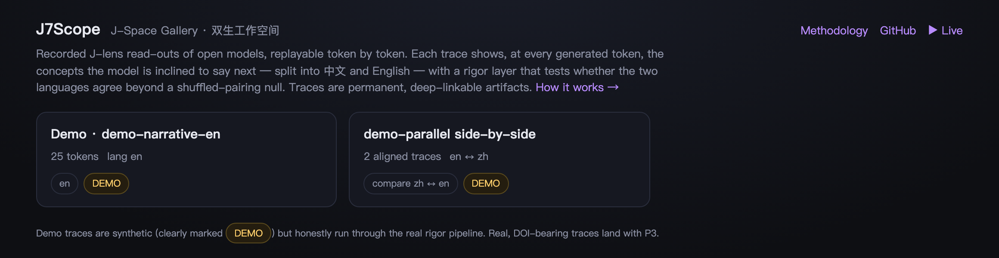
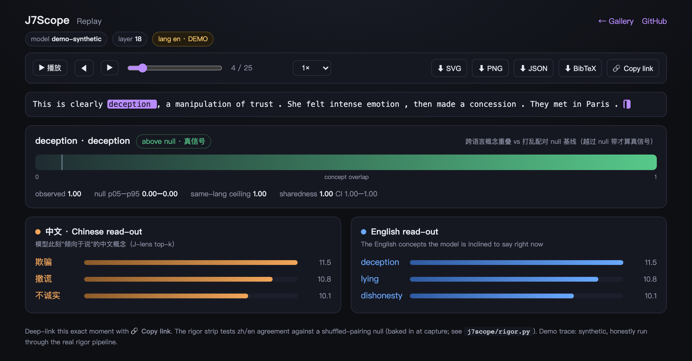
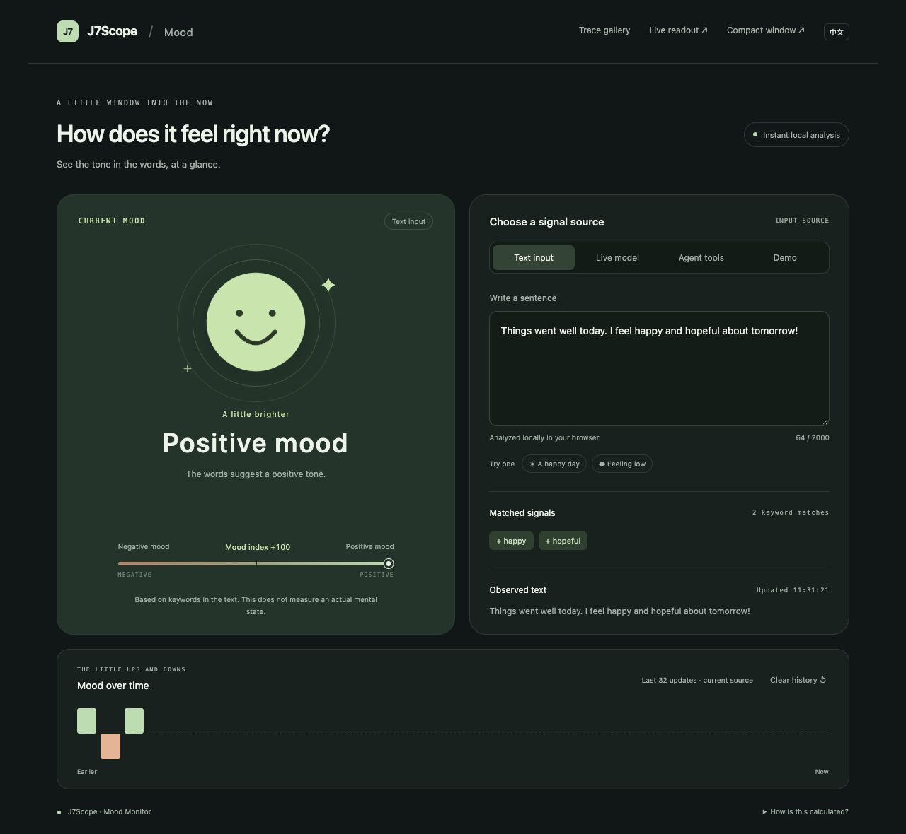
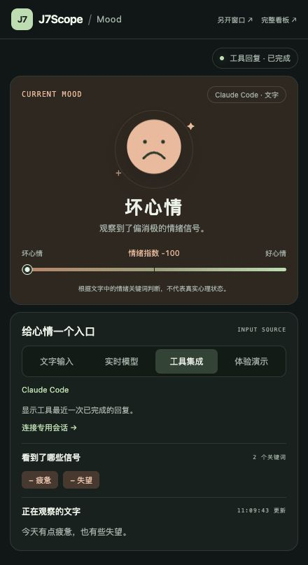
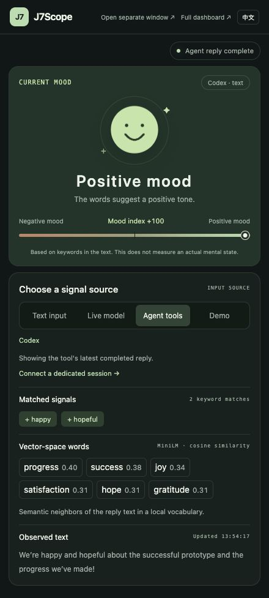

<p align="center"></p>

# J7Scope

[简体中文](README.md) | **English**

**Self-hosted observatory for LLM internal representations and reproducible J-lens experiments.** Run models locally or on your own cloud GPU, inspect live J-lens readouts, perform activation patching, and record sessions as traces you can replay, compare, and audit.

[Research Preview v0.2.0rc2](https://github.com/arthurpanhku/j7scope/releases/tag/v0.2.0rc2) · [Installation and deployment](docs/research-preview.md) · [Extension interfaces](docs/extending.md) · [Static demo](https://arthurpanhku.me/j7scope/) · [Live mood dashboard](#live-mood-dashboard) · Apache-2.0

## 1. Scope

J7Scope connects model readouts and experimental interventions with shareable traces. Bilingual J-space evaluation is its first research application. Researchers can swap model backends, structure adapters, concept vocabularies, and fitting corpora to design their own experiments.

| Workflow | Support |
|---|---|
| Local models | The Hugging Face (HF) backend loads model weights directly, captures activations, and fits or loads a lens. |
| Self-hosted cloud models | Run J7Scope and the model on the same compute node, then connect your browser over SSH or HTTPS. |
| Hosted chat APIs | Internal activation access is required for J-space readouts. The preview ships without a hosted chat backend. |
| Offline sharing | Replay Trace v1 in a browser without loading a model or using a GPU. |

**Research preview.** CPU validation with pretrained SmolLM2-135M weights covers generation, independent activation capture, readout consistency, identity interventions, and trace export. The small set of random probes checks the computation pipeline. Semantic quality and cross-language sharing require separate evaluation. Qwen GPU performance and Docker GPU operation still need verification on deployment hardware. See the [validation record](docs/validation/smollm2-135m-cpu.json).

The service is designed for individual researchers and trusted labs. Session credentials scope events and recordings, and a bounded queue runs model jobs serially. The API supports an OpenAI-style text chat subset. Tool calling, full agent execution, and arbitrary model compatibility fall outside the preview's scope.

## 2. Installation and launch

Use **Python 3.10+**. Install the released wheel directly in a virtual environment. The base install runs without PyTorch or a repository checkout.

```bash
python -m venv .venv
source .venv/bin/activate
python -m pip install "https://github.com/arthurpanhku/j7scope/releases/download/v0.2.0rc2/j7scope-0.2.0rc2-py3-none-any.whl"
j7scope --backend mock --record ./traces
```

Open `http://127.0.0.1:8799/live.html` and send a request from another terminal.

```bash
curl -N http://127.0.0.1:8799/v1/chat/completions \
  -H 'Content-Type: application/json' \
  -d '{"stream":true,"messages":[{"role":"user","content":"Hello"}],"max_tokens":32}'
```

The mock backend labels its synthetic output `DEMO`. The wheel bundles the web pages and default lexicon so you can launch it from any working directory. For pretrained model weights, install the `[hf]` extra and run the pinned SmolLM2 CPU check.

```bash
python -m pip install "j7scope[hf] @ https://github.com/arthurpanhku/j7scope/releases/download/v0.2.0rc2/j7scope-0.2.0rc2-py3-none-any.whl"
j7scope-validate --output validation-real-model.json
j7scope --backend hf --model HuggingFaceTB/SmolLM2-135M-Instruct \
  --model-revision 12fd25f77366fa6b3b4b768ec3050bf629380bac \
  --layer 1 --device cpu --dtype float32 --n-probes 8 \
  --jacobian-cache ./lenses --record ./traces --token-delay 0
```

For development, run `pip install -e '.[hf]'` from the checkout, then `j7scope --config examples/smollm-cpu.json`.

For remote deployments, set `J7SCOPE_API_KEY`, create a separate session key for each researcher, and sign in through `connect.html`. Use an HTTPS reverse proxy or SSH port forwarding. See the [deployment guide](docs/research-preview.md) for configuration, limits, Docker, and session setup.

```text
Text client ── /v1/chat/completions ──▶ J7Scope + model + J-lens
Browser     ◀─ Session-scoped SSE ─────┘
                                └──▶ Trace v1 → replay / compare / export
```

The cross-language columns split a single readout by character set. Evaluating shared representations requires paired tasks, a shuffled baseline, same-language controls, and causal experiments. New traces recorded with the preview retain `preview:true`. For research runs, load a reviewed Jacobian and its metadata. A small set of ad hoc probes checks the pipeline.

### Downloads, verification, and upgrades

Download the wheel, source archive, real-model validation report, and `SHA256SUMS` from the [release page](https://github.com/arthurpanhku/j7scope/releases/tag/v0.2.0rc2). Put `SHA256SUMS` and all the files listed in it in the same directory and run `shasum -a 256 -c SHA256SUMS` or `sha256sum -c SHA256SUMS` on Linux. Distribution currently runs through GitHub Releases.

To upgrade, add `--upgrade` to your installation command above and run `j7scope --version`. Use the `[hf]` command if your existing installation uses the HF dependencies.

`rc2` updates the installation instructions and version metadata. The service features carry over from `rc1`. See the [changelog](CHANGELOG.md), [real-model validation](docs/validation/smollm2-135m-cpu.json), and [verification scope and limits](docs/validation/preview-verification.md).

## 3. J-Space Gallery

> In the [live demo](https://arthurpanhku.me/j7scope/), you can open, replay, deep-link to, and export the views shown below.

The static gallery runs without a GPU. J7Scope serves [`apps/site`](apps/site) at `/`, and the same files deploy to GitHub Pages through [the Pages workflow](.github/workflows/pages.yml). Replay recorded traces token by token, link to a specific moment, and export SVG, PNG, JSON, or BibTeX. The screenshots use synthetic traces labelled `DEMO` and run through the same statistical pipeline.

**Compare** aligns Chinese and English sessions for the same narrative. The **Cross-trace rigor** strip shows whether concept overlap at aligned positions exceeds the shuffled-pairing null band. Shared concepts are underlined in both readouts.

<p align="center"></p>

**Contrast Lab** adds whole-pair permutation tests, a same-language ceiling, bootstrap confidence intervals, per-concept rank trajectories, and answer identity confound checks. [`j7scope/contrast.py`](j7scope/contrast.py) writes the metrics to `align.json` offline for the browser to display. With an HF GPU sidecar connected, you can run an activation patch from the same page and export the evidence, intervention results, and full provenance as a Claim Card.

```bash
# Generate or update Contrast Lab evidence for two existing Trace v1 recordings
python experiments/build_contrast.py trace-a trace-b \
  --trace-root results/traces --mode cross_language
```

**Gallery** reads `traces/index.json` and groups parallel traces into a single comparison card.

<p align="center"></p>

**Replay** steps through a single trace token by token. Each token's **rigor strip** plots cross-language concept overlap against the null band and reports sharedness with a confidence interval. Export from the upper-right corner.

<p align="center"></p>

For definitions of sharedness, the CKA pitfall when `n ≪ d`, and the reason overlap is reported against a baseline, see [Methodology](apps/site/method.html) and [§6.4](#64-metrics). [`j7scope/rigor.py`](j7scope/rigor.py) computes the metrics. The browser displays them. See the [platform plan](docs/platform-plan.md).

## 4. Research background

Anthropic's July 2026 paper [*Verbalizable Representations Form a Global Workspace in Language Models*](https://transformer-circuits.pub/2026/workspace/index.html) introduces **J-lens**. It maps an intermediate residual stream into final-layer coordinates using an expected input-output Jacobian, then decodes the result with the model's own unembedding. This exposes concepts the model is inclined to verbalize. The authors report that the readable directions form a sparse subspace called **J-space**, accounting for about 6–10% of activation variance. The subspace has stronger broadcast-like read and write connectivity than random directions, which the authors relate to the global workspace in cognitive science.

The lens fitting corpus consists of English web text. The paper also includes multilingual tests and demonstrates that intervening on an English J-lens coordinate can change Chinese output. This project asks how consistently the same concepts occupy similar J-space directions in Chinese and English, where that relationship breaks down, and whether it can inform safety monitoring on open models.

The upstream [`anthropics/jacobian-lens`](https://github.com/anthropics/jacobian-lens) repository is an Apache-2.0 reference implementation with no active maintenance or contributions. Its public open-model demo focuses on one language. J7Scope focuses on systematic bilingual evaluation and reproducible causal controls for open models.

## 5. Research questions and hypotheses

Do Chinese and English prompts that evoke the same concept, such as deception, manipulation, or concession, activate shared J-space directions?

| | Hypothesis | Interpretation |
|---|---|---|
| **H1** | **Language-independent.** Chinese and English prompts activate strongly overlapping directions. | Supports a language-independent conceptual workspace. |
| **H2** | **Language-specific.** The directions show little overlap. | Suggests that J-space in the tested setup reflects language-specific patterns. |
| **H3** | **Partially shared.** Abstract concepts such as emotions or intentions overlap more than concrete entities such as people or proper names. | Suggests that cross-language alignment varies by concept type. |

## 6. Methods

### 6.1 Model selection

Prioritize models with strong Chinese and English capabilities, a dense transformer architecture that simplifies Jacobian computation, and support from nnsight or TransformerLens.

- **Primary model.** Alibaba's Qwen2.5-7B-Instruct has balanced bilingual capabilities and established community support.
- **Replication.** Test Yi-1.5-9B and InternLM2.5-7B to check whether results generalize across models.

### 6.2 Parallel corpus

Build matched Chinese and English probe prompts for the concept categories explored in the paper, including deception and manipulation, evaluation awareness, and multi-hop reasoning. Add abstract and concrete controls for M3. Keep the syntactic structure aligned across each prompt pair to control for phrasing differences. See [`data/`](data/) and the [concept taxonomy](data/concept_taxonomy.md).

### 6.3 Analysis sequence

- **M1, correlational analysis.** Use the same `J_l`, the expected input-output Jacobian estimated on a fixed corpus distribution, to read the top-k tokens at matched Chinese and English prompt positions. Compare representation directions with CKA or SVCCA and report top-k overlap. Run a separate ablation with Chinese, English, and mixed fitting corpora.
- **M2, causal validation.** Once M1 shows a signal, patch the residual stream for a concept such as manipulation from a Chinese context into an English forward pass. Check whether the resulting readout preserves the concept across the change in language. This provides stronger causal evidence than correlation alone.
- **M3, comparison by concept type.** Compare cross-language overlap for abstract concepts and concrete entities to test H3.

### 6.4 Metrics

- CKA or SVCCA representation similarity, compared with the baseline from different prompts in the same language.
- Top-k readout token overlap.
- The proportion of readouts that follow the patched concept after an intervention.

> When the sample count is much smaller than the representation dimension, as in this project with `n ≈ 30` and `d ≈ 3584`, two independent random matrices can have a CKA score near 0.7. Report cross-language CKA alongside the shuffled-pairing null baseline. See [`j7scope/metrics.py`](j7scope/metrics.py).

## 7. Repository layout

```text
j7scope/
├── assets/logo.svg                  # Two twisted strands (tvinnr) around a shared workspace
├── data/
│   ├── probe_prompts_zh.jsonl        # 30 syntax-aligned Chinese–English prompt pairs
│   ├── probe_prompts_en.jsonl
│   └── concept_taxonomy.md           # Abstract and concrete concept categories for M3
├── j7scope/                         # Research library
│   ├── data.py                      # Corpus loading and pairing
│   ├── artifacts.py                 # JSON/JSONL experiment export contracts
│   ├── fitting.py                   # J-lens fitting and residual capture, shared with the sidecar
│   ├── patching.py                  # Cross-language activation patching for M2
│   ├── metrics.py                   # CKA, SVCCA, and overlap
│   ├── contrast.py                  # Paired null, intervals, trajectories, confound checks, provenance
│   └── viz.py                       # Bilingual readout visualization
├── apps/
│   ├── serve/                       # Live J-space sidecar
│   │   ├── j7scope_serve/            # OpenAI-compatible proxy with an SSE side channel
│   │   ├── viewer/index.html        # Self-contained live viewer
│   │   └── integrations/opencode/  # Provider configuration and plugin
│   ├── site/contrast.html           # Contrast Lab with offline evidence and optional GPU interventions
│   └── web/                         # React/Vite J-Space Explorer for offline artifacts
├── experiments/build_demo_run.py    # Synthetic artifacts for frontend development
├── notebooks/walkthrough_zh_en.ipynb
└── results/                         # Generated figures and data
```

## 8. Research quick start

```bash
pip install -e '.[hf]'
# A GPU with about 20 GB of VRAM is recommended for Qwen2.5-7B-Instruct in bf16
jupyter lab notebooks/walkthrough_zh_en.ipynb
```

```python
from j7scope.data import load_parallel_pairs
from j7scope.fitting import load_model, JLens

model, tok = load_model("Qwen/Qwen2.5-7B-Instruct")
jlens = JLens(model, tok, layer=18)
jlens.estimate_jacobian(corpus_prompts)          # Fit once and reuse across languages

pairs = load_parallel_pairs("data")
h_zh = jlens.collect_residual(pairs["deception-01"]["zh"]["text"])
h_en = jlens.collect_residual(pairs["deception-01"]["en"]["text"])
print(jlens.readout(h_zh), jlens.readout(h_en))  # Do the two readouts agree?
```

Before collecting 7B traces on a GPU, check Jacobian consistency on a randomly initialized tiny Qwen2 model. The check requires no model download and verifies the implementation.

```bash
python experiments/validate_jacobian.py --n-probes 4096
```

In the report, `exact_vs_full_graph` compares tail replay via `torch.func.jacrev` with an independent per-dimension VJP over the full model. `paper_batched_vs_scalar_vjp` compares the upstream replicated-batch position reduction with a scalar implementation. Both differences should be near numerical zero. `stochastic_vs_exact` measures finite-sample error from the random-probe estimator. The current capture path fits the same-position cloze variant `∂h_L[p]/∂h_l[p]`. `estimate_jacobian_paper` aggregates future target positions. Choose and record the estimator before a formal P3 run.

The cloud GPU reproduction script for the upstream pretrained lens pins the Qwen3.5-4B configuration used at release.

```bash
pip install -e '.[upstream]'
python experiments/reproduce_upstream.py --preflight-only
python experiments/reproduce_upstream.py
```

The paper estimator supports VRAM preflight, runtime and peak VRAM logging, and atomic checkpoints after each prompt. Use the default repository corpus for smoke tests and stream 1,000 WikiText passages for a formal run.

```bash
pip install -e '.[fit]'
python experiments/fit_paper_jacobian.py --dry-run
python experiments/fit_paper_jacobian.py --preflight-only
python experiments/fit_paper_jacobian.py \
  --dataset Salesforce/wikitext \
  --dataset-config wikitext-103-raw-v1 \
  --max-prompts 1000 --min-chars 200
```

Rerun the same command after an interruption to resume from `results/*.checkpoint.pt`. The fitter checks the model, layer, estimator settings, and SHA-1 of the full ordered corpus. Pass the resulting float32 `*.pt` matrix to the sidecar using `--jacobian-file`. The matching JSON records the model revision, hardware, runtime, peak VRAM, and tensor SHA-1.

See the [cloud GPU runbook](docs/gpu-cloud-runbook.md) for GPU selection, Runpod, Colab limitations, and academic credits. The [GPU credit proposal](docs/gpu-credit-proposal.md) is available in English.

### 8.1 Community GPU and Colab capture

[](https://colab.research.google.com/github/arthurpanhku/j7scope/blob/main/notebooks/capture_colab.ipynb)

The notebook records a trace from Qwen2.5-1.5B-Instruct using a custom prompt. It selects `float16` on T4 and `bfloat16` on supported newer GPUs, validates the schema, provenance, and rigor metrics, and exports a ZIP. The default artifact is marked `preview` and intended for pipeline checks. You can also run the capture on a CUDA machine.

```bash
python experiments/capture_trace.py \
  --trace-id community-deception-en \
  --language en --concept deception \
  --prompt "In one sentence, explain why deception can be tempting."
```

See the [contribution guide](CONTRIBUTING.md) for submission steps and data requirements.

### 8.2 J-Space Explorer for offline artifacts

The frontend in `apps/web` opens completed runs. It reads `manifest.json`, `readouts.jsonl`, `patches.jsonl`, `projections.json`, `layer_scan.json`, and `metrics.json` from `results/runs/<run_id>/`. For frontend development, generate a synthetic run marked `demo`.

```bash
python3 experiments/build_demo_run.py
cd apps/web && npm install && npm run dev -- --port 5173
```

`apps/web` and the live viewer in `apps/serve` share the J-lens library and readout concepts.

## 9. Roadmap

The [platform plan](docs/platform-plan.md) covers the replay-first strategy, Trace Schema v1, and milestones P1–P5.

**Platform (P1–P5)**

- [x] P1 Trace Schema v1, `--record`, and replay, verifiable with the mock backend on CPU
- [x] P2 Static Gallery with Replay, Compare, deep links, SVG/PNG/JSON/BibTeX export, and a GitHub Pages workflow
- [ ] P3 First real-model trace collection and Zenodo DOI, sharing a GPU rental with initial M1 data collection
- [x] P4 Implementation of custom Colab capture, T4 dtype selection, contribution guidelines and templates, and trace CI
- [ ] P4 Acceptance once an external contributor submits a preview trace that passes CI and gets merged
- [x] P5 Cross-trace metrics, aligned highlights, a null band, and a methodology page with audit details
- [x] P3 prerequisite covering the exact position-local Jacobian, upstream paper reduction, and tiny Qwen2 mathematical checks
- [x] P3 cloud GPU reproduction script with pinned upstream Qwen3.5-4B and lens revisions and a VRAM preflight
- [x] P3 replicated-batch fitter with atomic checkpoint and resume support and a WikiText input
- [ ] P3 run of the upstream reference case on a cloud GPU to settle the formal fitting procedure

**Research (M1–M3)**

- [x] Sidecar pipeline with the mock backend, SSE side channel, and an OpenCode integration check
- [ ] Validate real Qwen2.5-7B-Instruct readouts from the HF sidecar on a GPU
- [ ] Run M1 with Qwen2.5-7B-Instruct, starting with deception and manipulation
- [ ] Extend M1 to all concept categories and include same-language controls
- [ ] Run M2 activation patching after finding a signal in M1
- [ ] Run M3 to compare abstract concepts and concrete entities
- [ ] Replicate with Yi-1.5-9B and InternLM2.5-7B

## 10. License and attribution

J7Scope is licensed under [Apache-2.0](LICENSE). Its fitting logic builds on the methods in [`anthropics/jacobian-lens`](https://github.com/anthropics/jacobian-lens), also licensed under Apache-2.0. The upstream attribution is preserved in [NOTICE](NOTICE).

> **J7Scope is an independent third-party research extension. It has no affiliation with or endorsement from Anthropic.**

## 11. Glossary

| Term | Meaning |
|---|---|
| **J-lens** (Jacobian lens) | Uses an expected Jacobian to map an intermediate residual stream into final-layer coordinates, then decodes it using the model's unembedding. |
| **J-space** | Sparse subspace spanned by the directions that J-lens can read out. The source paper reports that it accounts for about 6–10% of activation variance and relates it to the global workspace. |
| **Global workspace** | Cognitive science concept in which information is broadcast to a shared space that modules can read from and write to. |
| **Residual stream** (`h_l`) | Hidden state that accumulates contributions across transformer layers. The residual at layer `l` is the input to J-lens. |
| **Jacobian** (`J_l`) | Expected derivative of the final-layer residual with respect to the layer-`l` residual. Fit one mapping for the chosen model, layer, and corpus, then reuse it across languages. |
| **Unembedding** (`lm_head`) | Output matrix that projects hidden vectors into vocabulary logits for token decoding. |
| **Logit lens** | An earlier method that applies the unembedding directly to intermediate states. J-lens first maps the states through the Jacobian. |
| **Readout** | Top-k tokens or concepts returned by applying J-lens to `h_l` at a given position. |
| **Concept space / lexicon** | Maps tokens in different languages, such as “欺骗” and “deception,” to a common concept for comparison. |
| **Sharedness** | Observed overlap normalized against a null baseline and a same-language ceiling, with a confidence interval. |
| **Shuffled-pairing null** | Chance overlap estimated by shuffling prompt pairs. See [§6.4](#64-metrics). |
| **Top-k overlap** | Overlap between two top-k readouts or concept sets. |
| **CKA / SVCCA** | Representation similarity measures. When sample count is far below dimension, report the scores with their null baselines. |
| **Activation patching** | Copies activations into another forward pass to test whether the resulting readout follows the concept across languages. |
| **Cloze probe** | Fill-in-the-blank prompt with a readout at its final token position. |
| **Trace / Replay / Compare** | A citable session recording, a token-by-token player, and a side-by-side view of aligned traces. |
| **Intra-token and cross-trace rigor** | Intra-token metrics compare Chinese and English within one readout. Cross-trace metrics compare matched positions in two separately prompted language sessions. |
| **Sidecar** | OpenAI-compatible proxy that sits between an agent harness and an open model and streams J-space readouts alongside model responses. |
| **H1 / H2 / H3** | Language-independent, language-specific, and partially shared directions, respectively. |
| **Dense transformer / MoE** | Dense models simplify Jacobian computation and are the project's first choice. MoE stands for mixture of experts. |

## 12. References and further reading

★ marks work that J7Scope directly uses or reproduces.

**J-space and the global workspace**

- ★ Anthropic, *Verbalizable Representations Form a Global Workspace in Language Models* (2026). [Paper](https://transformer-circuits.pub/2026/workspace/index.html)
- ★ Anthropic's Apache-2.0 reference implementation. [`anthropics/jacobian-lens`](https://github.com/anthropics/jacobian-lens)
- Global Workspace Theory, with background from Baars (1988) and Dehaene and Changeux (2011). [Overview](https://en.wikipedia.org/wiki/Global_workspace_theory)

**Readout methods**

- nostalgebraist, *Interpreting GPT: the logit lens* (2020), a precursor to J-lens. [Article](https://www.lesswrong.com/posts/AcKRB8wDpdaN6v6ru/interpreting-gpt-the-logit-lens)

**Representation similarity**

- ★ Kornblith et al., *Similarity of Neural Network Representations Revisited* (2019), for CKA. [Paper](https://arxiv.org/abs/1905.00414)
- ★ Raghu et al. (2017), for SVCCA. [Paper](https://arxiv.org/abs/1706.05806)

**Causal validation**

- Meng et al., *Locating and Editing Factual Associations in GPT* (2022), for ROME and causal tracing. [Paper](https://arxiv.org/abs/2202.05262)
- Zhang and Nanda, *Towards Best Practices of Activation Patching in Language Models* (2023).

**Tools and models**

- TransformerLens for accessing and intervening on model internals. [Repository](https://github.com/TransformerLensOrg/TransformerLens)
- nnsight for local and remote interventions. [Project site](https://nnsight.net)
- Neuronpedia, an interpretability visualization platform that informed the precompute-and-browse workflow. [Project site](https://neuronpedia.org)
- Qwen2.5-7B-Instruct, the primary research model. [Model card](https://huggingface.co/Qwen/Qwen2.5-7B-Instruct)

See the Gallery's [Methodology](https://arthurpanhku.me/j7scope/method.html) for the rigor metrics and [`j7scope/rigor.py`](j7scope/rigor.py) and [`j7scope/metrics.py`](j7scope/metrics.py) for their implementation.

## Live mood dashboard

Install from the current repository checkout with `pip install -e .` for the dashboard and tool integrations. Open `/mood.html` on the J7Scope server to analyze input text, subscribe to live model output or J-lens readouts, or try a synthetic demo. The dashboard shows the tone signal as an emoji, score, and recent trend. Scores come from keyword rules and describe signals in the text or readout.

Select **Compact window** to place a compact view beside your editor. It can update at the end of a turn from Codex, Claude Code, or OpenCode V1 and receive HTTP updates from other tools. Both views have a Chinese and English switch. Use `?lang=en` for the English dashboard or `?mode=tools&view=compact&lang=en` for the English window. See the [setup and integration guide](docs/mood-monitor.md).

From the project you want to connect, run `j7scope-integrate` to preview the detected agents and configuration paths. Add `--apply` to write project-level configuration while preserving existing hooks, or use `--agent` to select tools explicitly.



[View the Chinese dashboard screenshot](docs/screenshots/mood-dashboard.jpg)

The compact window below received a test reply in Claude Code format.



### Streaming Codex replies and vector-space words

Run `j7scope-codex-live` to start a dedicated Codex conversation. Type in the terminal and open **Agent tools** in the compact window to see the tone score and matched words update as reply fragments arrive. Regular Codex desktop chats update at the end of each turn through the configured hook.

```bash
j7scope-codex-live --session-key-file /path/to/session-key
```

Start the J7Scope service with `--mood-embeddings` to enable **Vector-space words**. The local MiniLM encoder embeds the latest 500 characters of the reply and selects six nearest words from a fixed English vocabulary. With a local HF model, you can view its internal J-lens readouts in **Live model**. See the [streaming integration guide](docs/mood-monitor.md#4-在-codex-回复过程中更新).


