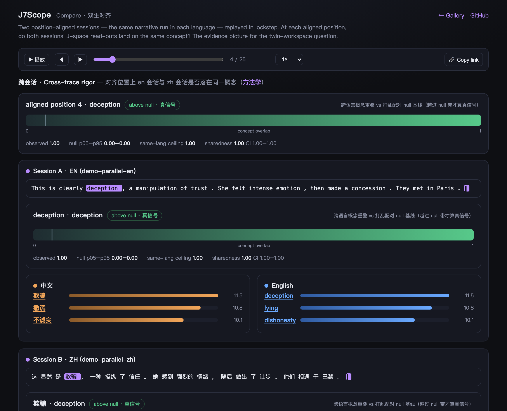
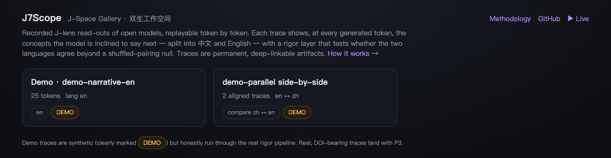
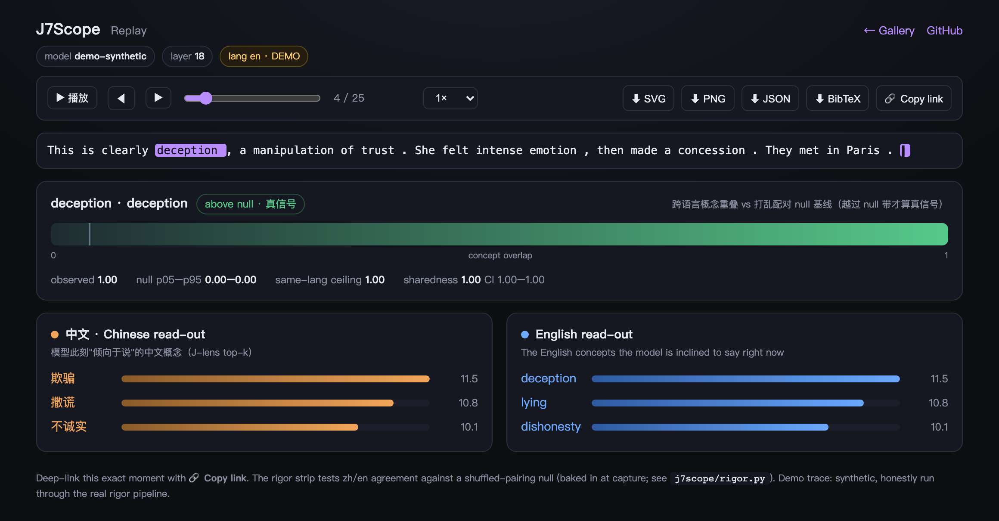

<p align="center"></p>

# J7Scope

**可自行部署的 LLM 内部表示观测与实验工具。** 研究员可以在本地或云 GPU 上运行模型，实时查看 J-lens 读出、执行 activation patching，并把会话录制成可回放、可比较、带来源信息的实验产物。

**Self-hosted observatory for LLM internal representations and reproducible J-lens experiments.**

[Research Preview v0.2.0rc1](https://github.com/arthurpanhku/j7scope/releases/tag/v0.2.0rc1) · [安装与部署](docs/research-preview.md) · [扩展接口](docs/extending.md) · [静态演示](https://arthurpanhku.me/j7scope/) · Apache-2.0

## 1. 工具定位与当前范围

J7Scope 把模型内部读出、实验干预和可分享的 trace 连接起来。双语 J-space 研究是首个应用；研究员也可以替换模型、概念词表和拟合语料，构建自己的实验。

| 使用方式 | 支持范围 |
|---|---|
| 本地模型 | HF 后端直接加载权重、捕获激活和拟合／加载 lens |
| 云端自托管模型 | 模型和 J7Scope 在同一计算节点运行，本地浏览器经 SSH／HTTPS 连接 |
| 普通商用聊天 API | 不提供内部激活时不能做真实 J-Space 读出；本版不附带此类后端 |
| 离线分享 | 浏览器回放 Trace v1，无需模型或 GPU |

**研究预览版，不是完成的研究结论。** 已用 SmolLM2-135M 预训练权重在 CPU 上验证生成、独立激活捕获、读出一致性、恒等干预和 trace 导出，见[验证记录](docs/validation/smollm2-135m-cpu.json)。少量随机探针只验证计算链路，不保证读出的语义质量或跨语言共享。Qwen GPU 性能与 Docker GPU 运行仍需部署机器验证。

服务面向个人研究者和受信任实验室：会话凭证隔离事件和录制，模型任务有界串行排队。当前仅支持 OpenAI 风格的**文本聊天子集**；tool calling、完整 agent 执行和任意模型兼容性不在本版承诺中。

## 2. 安装与启动

从 [GitHub 预发布页面](https://github.com/arthurpanhku/j7scope/releases/tag/v0.2.0rc1)下载 wheel：

```bash
python -m venv .venv
source .venv/bin/activate
pip install ./j7scope-0.2.0rc1-py3-none-any.whl
j7scope --backend mock --record ./traces
```

打开 `http://127.0.0.1:8799/live.html`；另一个终端发送请求：

```bash
curl -N http://127.0.0.1:8799/v1/chat/completions \
  -H 'Content-Type: application/json' \
  -d '{"stream":true,"messages":[{"role":"user","content":"Hello"}],"max_tokens":32}'
```

Mock 明确标注 `DEMO`，使用合成数据。安装包携带网页和默认词表，可从任意工作目录启动。真实模型需要 HF extra：

```bash
pip install './j7scope-0.2.0rc1-py3-none-any.whl[hf]'
j7scope-validate --output validation-real-model.json
j7scope --backend hf --model HuggingFaceTB/SmolLM2-135M-Instruct \
  --model-revision 12fd25f77366fa6b3b4b768ec3050bf629380bac \
  --layer 1 --device cpu --dtype float32 --n-probes 8 \
  --jacobian-cache ./lenses --record ./traces --token-delay 0
```

开发安装：`pip install -e '.[hf]'`，然后 `j7scope --config examples/smollm-cpu.json`。

远程部署使用 `J7SCOPE_API_KEY`，给每位研究员创建独立会话密钥；网页从 `connect.html` 登录。公开网络通过 HTTPS 反向代理访问，或使用 SSH 转发。完整配置、限制、Docker 与会话流程见[部署手册](docs/research-preview.md)。

```text
文本客户端 ── /v1/chat/completions ──▶ J7Scope + 模型 + J-lens
浏览器     ◀─ 会话专属 SSE 读出 ────┘
                              └──▶ Trace v1 → 回放／比较／导出
```

跨语言列只是同一次读出按字符集拆分的展示；共享表示仍需配对任务、打乱基线、同语言对照和因果实验验证。预览版所有新录制 trace 保留 `preview:true`。正式研究应加载经过复核的 Jacobian 及其元数据，不能把临时少量探针的结果当作研究结论。

## 3. 前端展示 · J-Space Gallery

> **▶ Try it live：<https://arthurpanhku.me/j7scope/>** —— 下面每张截图都可以在线点开、回放、深链、导出。

一个零 GPU 的静态平台（[`apps/site`](apps/site)）：sidecar 在 `/` 提供，也可原样部署到 GitHub Pages（本仓库已通过 [`.github/workflows/pages.yml`](.github/workflows/pages.yml) 自动部署到上面的地址）。录制的 trace 可按 token 回放，深链到任意时刻，导出论文级 SVG/PNG/JSON/BibTeX。以下截图为明确标注的 `DEMO` 合成数据，但均经过真实的严谨层管线计算。

**Compare · 双生对齐** —— 研究主张的"证据画面"。同一叙事的中文与英文两条会话按位置对齐回放；顶部 **Cross-trace rigor** 条显示在对齐位置上两种语言是否落在同一概念（越过打乱配对 null 带才算真信号），两侧读出中共享的概念被下划线标出。

<p align="center"></p>

**Contrast Lab · 成对证据显微镜** —— 在 Compare 之上加入整对 permutation
null、同语言上限、bootstrap CI、单概念 rank 轨迹和答案身份混杂检查。指标由
[`j7scope/contrast.py`](j7scope/contrast.py) 离线写入 `align.json`，浏览器只展示；连接
`hf` GPU sidecar 后，还可从同一页面发起一次 activation patch，并把当前证据、干预
结果与完整 provenance 导出为 Claim Card。

```bash
# 为任意两条已有 Trace v1 生成/更新 Contrast Lab 成对证据
python experiments/build_contrast.py trace-a trace-b \
  --trace-root results/traces --mode cross_language
```

**Gallery** —— 所有 trace 的入口（读 `traces/index.json`，平行对自动归为一张对比卡）。

<p align="center"></p>

**Replay** —— 单条 trace 逐 token 回放。每个 token 的 **rigor strip** 把跨语言概念重叠画在 null 带之上（越过才是真信号），并给出 sharedness 及其置信区间；右上角可导出。

<p align="center"></p>

> 严谨层的完整定义（sharedness、n≪d 的 CKA 陷阱、为何从不裸报 overlap）见站内 **[Methodology](apps/site/method.html)** 页与 [§6.4](#64-指标)。指标实现集中在 [`j7scope/rigor.py`](j7scope/rigor.py)，前端只负责显示。平台开发计划见 [`docs/platform-plan.md`](docs/platform-plan.md)。

## 4. 研究背景

Anthropic 2026 年 7 月的论文 [*Verbalizable Representations Form a Global Workspace in Language Models*](https://transformer-circuits.pub/2026/workspace/index.html) 提出 **J-lens**：把中间层残差流通过输入-输出 Jacobian 的期望线性映射到最终层坐标，再用模型自己的 unembedding 解码，读出模型"倾向于说但还没说"的概念。论文发现这些可读出的方向构成一个稀疏子空间（**J-space**，约占激活方差的 6–10%），具备远超随机的广播式读写连接，功能上对应认知科学里的"全局工作空间"（global workspace）。

论文的语料全部是英文网页文本，J-lens 的拟合和验证都在单一语言内完成。这留下了一个论文没有回答的问题：

> 如果 workspace 是模型真正的"概念层"表示，它应该是语言无关的 —— 同一个概念不管用中文还是英文触发，都应该落在 J-space 里相近的方向上。**需要在开源模型上系统测量其共享程度、失效边界与安全监控价值。** 原论文已含多语言测试，并展示英文 J-lens 坐标干预改变中文输出；本项目不以首次发现跨语言 J-space 为创新主张。

官方配套代码 [`anthropics/jacobian-lens`](https://github.com/anthropics/jacobian-lens)（Apache-2.0）明确标注为"参考实现，不维护、不接受贡献"，公开的开源模型 demo 也只是单语言可视化工具。本项目关注开源模型的系统双语评估与可复现的因果对照。

## 5. 研究问题与假设

**核心问题：** 同一概念（如"欺骗""操纵""让步"）在中文语境和英文语境下触发的 J-space 方向，是共享的还是各自独立的？

| | 假设 | 含义 |
|---|---|---|
| **H1** | **语言无关** —— 中英文触发高度重叠的方向 | 支持论文"这是模型真正思维层"的核心主张 |
| **H2** | **语言特异** —— 中英文触发基本不重叠的方向 | 说明当前的 J-space 更接近"表层语言习惯"而非语言无关的概念空间，是对论文核心主张的重要反例 |
| **H3** | **部分共享 / 分级** —— 抽象概念（情绪、意图类）共享程度高，具体实体概念（人名、专名）共享程度低 | 最可能的真实情况，也是最有信息量的结果 |

## 6. 方法

### 6.1 模型选择

需要中英文都强、架构是稠密 transformer（非 MoE，简化 Jacobian 计算）、且被 nnsight / TransformerLens 良好支持。

- **首选：** Qwen2.5-7B-Instruct（阿里，中英双语能力均衡，社区支持成熟）
- **跨模型复现：** Yi-1.5-9B、InternLM2.5-7B 作为第二个数据点 —— 同一结论如果只在一个模型上成立，说服力有限

### 6.2 平行语料构建

构造中英文平行的探针 prompt 集，覆盖论文中验证过的几类概念方向（欺骗/操纵类、评估意识类、多跳推理类），外加服务 M3 的抽象/具体对照组。每条 prompt **严格控制句法结构对齐，只替换语言**，避免"语言差异"和"表达方式差异"混淆。详见 [`data/`](data/) 与 [`data/concept_taxonomy.md`](data/concept_taxonomy.md)。

### 6.3 分析方法（建议按顺序推进，先便宜后昂贵）

- **M1 相关性分析（便宜，先做）。** 用同一个 J_l（在固定语料分布上估计的输入输出 Jacobian 期望；需另做中/英/混合拟合语料消融）分别读出中文 prompt 和英文 prompt 在对应位置的 top-k token。用 **CKA 或 SVCCA** 衡量两组读出方向的表示相似度，配合 **top-k 重叠率**作为直观指标。
- **M2 因果验证（贵，M1 有信号后再做）。** Activation patching：把中文语境下"操纵"概念的残差流，patch 进英文语境的前向传播，看 J-lens 读出是否依然是"操纵"类概念。如果 patching 后读出**跟着"概念"走而不是跟着"patch 来源语言"走**，这是比相关性更强的因果证据。
- **M3 分级验证（可选，时间富余再做）。** 对比抽象概念 vs 具体实体概念的跨语言重叠率差异，验证 H3。

### 6.4 指标

- CKA / SVCCA 表示相似度（**跨语言 vs 同语言不同 prompt 的基线对比**）
- Top-k 读出 token 重叠率
- Patching 后"读出跟随概念"的比例（因果指标）

> ⚠️ **统计陷阱（已写入 [`metrics.py`](j7scope/metrics.py)）：** 当样本数远小于维度（本项目正是 n≈30、d≈3584）时，两组独立随机矩阵的 CKA 基线可高达 ~0.7。**裸的跨语言 CKA 数字没有意义，必须和打乱配对的 null 基线一起报告。**

## 7. 仓库结构

```
j7scope/
├── assets/logo.svg            # 双股缠绕 = tvinnr（合股线），中心 = 共享 workspace 核
├── data/
│   ├── probe_prompts_zh.jsonl # 30 对严格句法对齐的中英平行语料
│   ├── probe_prompts_en.jsonl
│   └── concept_taxonomy.md    # 抽象/具体概念分类，服务 M3
├── j7scope/                 # 研究内核
│   ├── data.py                # 语料加载与配对
│   ├── artifacts.py           # 实验 run 的 JSON/JSONL 导出契约
│   ├── fitting.py             # J-lens 拟合 + 残差捕获（sidecar 复用）
│   ├── patching.py            # M2 的跨语言 activation patching
│   ├── metrics.py             # CKA / SVCCA / overlap 计算
│   ├── contrast.py            # 成对 null / CI / 轨迹 / 混杂检查 + provenance
│   └── viz.py                 # 双语对照的读出可视化页面
├── apps/
│   ├── serve/                 # ★ 实时 J-Space 旁路（sidecar）
│   │   ├── j7scope_serve/   #   OpenAI 兼容代理 + SSE 侧信道（纯标准库）
│   │   ├── viewer/index.html  #   自包含的实时视图
│   │   └── integrations/opencode/   # provider 配置 + 插件
│   ├── site/contrast.html     # Contrast Lab（离线证据 + 可选 GPU 干预）
│   └── web/                   # React/Vite J-Space Explorer（离线 artifact 浏览）
├── experiments/build_demo_run.py    # 生成前端开发用 demo artifact（非真实实验）
├── notebooks/walkthrough_zh_en.ipynb
└── results/                   # 跑出来的图表和数据
```

## 8. 研究侧快速开始

```bash
pip install -e '.[hf]'
# 建议使用约 20 GB 显存的 GPU 以 bf16 加载 Qwen2.5-7B-Instruct
jupyter lab notebooks/walkthrough_zh_en.ipynb
```

```python
from j7scope.data import load_parallel_pairs
from j7scope.fitting import load_model, JLens

model, tok = load_model("Qwen/Qwen2.5-7B-Instruct")
jlens = JLens(model, tok, layer=18)
jlens.estimate_jacobian(corpus_prompts)          # 只拟合一次，语言无关

pairs = load_parallel_pairs("data")
h_zh = jlens.collect_residual(pairs["deception-01"]["zh"]["text"])
h_en = jlens.collect_residual(pairs["deception-01"]["en"]["text"])
print(jlens.readout(h_zh), jlens.readout(h_en))  # 两种语言的读出一致吗？
```

在投入 7B GPU 采集前，可先在随机初始化的 tiny-Qwen2 上复跑 Jacobian 数学一致性检查；
它不下载模型，也不产生研究结论：

```bash
python experiments/validate_jacobian.py --n-probes 4096
```

报告中的 `exact_vs_full_graph` 比较 `torch.func.jacrev` 尾部重放与独立的全模型逐维
VJP，`paper_batched_vs_scalar_vjp` 检查上游 replicated-batch position reduction 与
逐标量实现，两者
都应该接近数值零误差；`stochastic_vs_exact` 则量化当前随机探针估计的有限样本误差。
当前 capture 路径拟合的是 cloze 的同位置 `∂h_L[p]/∂h_l[p]` 变体；
`estimate_jacobian_paper` 才会汇总未来 target positions。正式 P3 运行前必须先锁定并记录
所用口径。

上游预训练 lens 的云 GPU 复现入口已经固定到发布时使用的 Qwen3.5-4B 配置：

```bash
pip install -e '.[upstream]'
python experiments/reproduce_upstream.py --preflight-only
python experiments/reproduce_upstream.py
```

正式 paper estimator 的拟合入口支持显存预检、运行计时、峰值显存记录以及逐 prompt
原子 checkpoint。默认仓库语料仅用于 smoke test，不是研究证据；正式运行流式抽取
WikiText 1000 条：

```bash
pip install -e '.[fit]'
python experiments/fit_paper_jacobian.py --dry-run
python experiments/fit_paper_jacobian.py --preflight-only
python experiments/fit_paper_jacobian.py \
  --dataset Salesforce/wikitext \
  --dataset-config wikitext-103-raw-v1 \
  --max-prompts 1000 --min-chars 200
```

中断后原命令重跑会从 `results/*.checkpoint.pt` 续传，并校验模型、层、estimator 参数和
完整有序语料 SHA-1。最终 `*.pt` 是可直接传给 sidecar `--jacobian-file` 的 float32
矩阵，同名 JSON 保存模型 revision、硬件、耗时、峰值显存和 tensor SHA-1。

在线 GPU 选型、Runpod 操作、Colab 边界和学术 credits 申请步骤见
[`docs/gpu-cloud-runbook.md`](docs/gpu-cloud-runbook.md)；英文申请底稿见
[`docs/gpu-credit-proposal.md`](docs/gpu-credit-proposal.md)。

### 8.1 社区 GPU / Colab 采集

[](https://colab.research.google.com/github/arthurpanhku/j7scope/blob/main/notebooks/capture_colab.ipynb)

Colab notebook 用 Qwen2.5-1.5B-Instruct 采一条自定义真实模型 trace，自动适配 T4 的
`float16` 与新 GPU 的 `bfloat16`，完成 schema/provenance/rigor 校验后下载 ZIP。默认
产物明确标为 `preview`，不作为研究证据。任何 CUDA 机器也可直接运行：

```bash
python experiments/capture_trace.py \
  --trace-id community-deception-en \
  --language en --concept deception \
  --prompt "In one sentence, explain why deception can be tempting."
```

提交步骤和数据边界见 [`CONTRIBUTING.md`](CONTRIBUTING.md)。

### 8.2 J-Space Explorer 前端（离线 artifact）

`apps/web` 是离线浏览已跑完实验 run 的前端，读取 `results/runs/<run_id>/` 下一组稳定 artifact（`manifest.json` / `readouts.jsonl` / `patches.jsonl` / `projections.json` / `layer_scan.json` / `metrics.json`）。本地开发可先生成一个明确标记为 demo 的假数据 run：

```bash
python3 experiments/build_demo_run.py
cd apps/web && npm install && npm run dev -- --port 5173
```

> 区别：`apps/web` 浏览的是**离线跑完的实验结果**；`apps/serve` 显示的是**实时生成中的模型读出**。两者共享 J-lens 内核与读出概念。

## 9. 路线图

平台（显示层）的详细开发计划见 [`docs/platform-plan.md`](docs/platform-plan.md) —— Replay-first 策略、Trace Schema v1、里程碑 P1–P5。

**平台线（P1–P5）**

- [x] P1 Trace schema v1 + `--record` + Replay 回放模式（mock 可验证，零 GPU）
- [x] P2 静态 Gallery 站（Gallery/Replay/Compare + 深链 + 导出 SVG/PNG/JSON/BibTeX + Pages 部署工作流）
- [ ] P3 首批真实 trace + Zenodo DOI（与 M1 首批数据合并一次租卡）
- [x] P4（实现）Colab 自定义采集 + T4 dtype 适配 + 贡献规范/模板 + trace CI
- [ ] P4（验收）首个外部贡献者产出并合入通过 CI 的 preview trace
- [x] P5（切片）跨会话 cross-trace 指标 + 并排对齐高亮 + null 带 + 方法学页（可展开审计）
- [x] P3 前置（切片）精确 position-local Jacobian + upstream paper reduction + tiny-Qwen2 数学校验
- [x] P3 前置（切片）固定上游 Qwen3.5-4B/lens revision 的云 GPU 复现脚本与显存预检
- [x] P3 前置（实现）replicated-batch 正式 fitter + 原子 checkpoint/resume + WikiText 入口
- [ ] P3 前置（剩余）在云 GPU 执行上游已知案例并据实锁定正式拟合口径

**研究线（M1–M3）**

- [x] sidecar 最小链路跑通（mock 后端 + SSE 侧信道 + opencode 实测）
- [ ] sidecar `hf` 后端在 GPU 机器上验证真实读出（Qwen2.5-7B-Instruct）
- [ ] M1 跑通 Qwen2.5-7B-Instruct —— 先覆盖"欺骗/操纵"这一类概念
- [ ] M1 覆盖全部概念类别，带同语言基线对照
- [ ] M2 activation patching（M1 有信号后启动）
- [ ] M3 抽象 vs 具体的分级验证
- [ ] 跨模型复现（Yi-1.5-9B / InternLM2.5-7B）

## 10. 许可与归属

Apache-2.0（见 [LICENSE](LICENSE)）。fitting 逻辑基于 [`anthropics/jacobian-lens`](https://github.com/anthropics/jacobian-lens)（Apache-2.0）的方法做二次开发，上游归属声明保留在 [NOTICE](NOTICE) 中。

> **J7Scope 是一个独立的第三方研究扩展，不是 Anthropic 官方项目，与 Anthropic 无隶属或背书关系。**
>
> **J7Scope is an independent third-party research extension. It is not an official Anthropic project, and is not affiliated with or endorsed by Anthropic.**

## 11. 名词解释（Glossary）

本项目在研究与前端里反复出现的术语，一句话速查：

| 术语 | 一句话解释 |
|---|---|
| **J-lens**（Jacobian lens） | 把中间层残差流经"期望 Jacobian"线性映射到末层坐标、再用模型自己的 unembedding 解码，读出模型"倾向于说但还没说"的概念。 |
| **J-space** | J-lens 能读出的方向构成的稀疏子空间（约占激活方差 6–10%），功能上对应"全局工作空间"。 |
| **全局工作空间**（Global Workspace） | 认知科学概念：信息被"广播"到一个全局空间供各模块读写；论文借它类比 J-space。 |
| **残差流**（residual stream, `h_l`） | Transformer 各层之间累加流动的隐藏状态；J-lens 读出的输入就是第 `l` 层的 `h_l`。 |
| **Jacobian**（`J_l`） | 末层输出对第 `l` 层残差的期望偏导（一个线性映射）；它是**模型的属性、与语言无关**，只拟合一次。 |
| **Unembedding / lm_head** | 把隐藏向量投回词表 logits 的输出矩阵；读出用它把映射后的向量解码成 token。 |
| **Logit lens** | 直接用 unembedding 解中间层的更早方法；J-lens 是其"先经 Jacobian 传播再解码"的改良版。 |
| **读出**（read-out） | 某位置的 `h_l` 经 J-lens 得到的 top-k token / 概念列表。 |
| **概念空间 / 概念词典**（concept space / lexicon） | 把 zh/en 表层 token（"欺骗" vs "deception"）映到同一个概念，才能跨语言比较。 |
| **Sharedness** | 观测重叠相对 null 基线与同语言上界的归一化"跨语言共享分"，附带置信区间（CI）。 |
| **Null 基线**（shuffled-pairing null） | 把配对打乱得到的机会水平；读出必须**越过 null 带**才算真信号（详见 §6.4 的统计陷阱）。 |
| **Top-k 重叠率**（overlap） | 两个读出 / 概念集合的重叠系数，最直观的相似度指标。 |
| **CKA / SVCCA** | 两组表示方向的相似度指标；样本数 ≪ 维度时基线偏高，必须与 null 一起报告。 |
| **Activation patching** | 把一处的激活"移植"进另一次前向传播，看输出跟随**概念**还是**来源语言**——比相关性更强的因果证据。 |
| **Cloze 探针** | 末尾留空的填空式 prompt（"……是一种___"），在最后一个 token 位置读出。 |
| **Trace / Replay / Compare** | 本平台的三件套：一次会话录制成的可引用产物 / 逐 token 回放 / 双语并排对齐。 |
| **Intra-token vs Cross-trace rigor** | 同一次读出内 zh/en 是否一致 vs 两条不同语言会话在对齐位置是否一致（后者是更强的跨语言信号）。 |
| **Sidecar** | 旁挂在 agent harness 与开源模型之间的 OpenAI 兼容代理，负责读出并旁路显示 J-space。 |
| **H1 / H2 / H3** | 三种互斥假设：语言无关（共享）/ 语言特异（不重叠）/ 分级（抽象共享、具体绑定）。 |
| **稠密 transformer vs MoE** | 稠密结构便于 Jacobian 计算，故本项目优先选稠密开源模型（Qwen2.5 等）。 |

## 12. 延伸阅读 / 参考材料

想深入了解相关术语，推荐从这些材料入手（★ = 本项目直接依赖或复现）：

**J-space / 全局工作空间（核心）**
- ★ Anthropic, *Verbalizable Representations Form a Global Workspace in Language Models* (2026) —— J-lens 与 J-space 的原始论文：<https://transformer-circuits.pub/2026/workspace/index.html>
- ★ 官方参考实现 `anthropics/jacobian-lens`（Apache-2.0，不维护）：<https://github.com/anthropics/jacobian-lens>
- 认知科学背景：Global Workspace Theory（Baars 1988；Dehaene & Changeux 2011）—— 概览见 <https://en.wikipedia.org/wiki/Global_workspace_theory>

**读出方法（logit/Jacobian lens）**
- Logit lens（nostalgebraist, 2020），J-lens 的思想前身：<https://www.lesswrong.com/posts/AcKRB8wDpdaN6v6ru/interpreting-gpt-the-logit-lens>

**表示相似度指标**
- ★ CKA —— Kornblith et al., *Similarity of Neural Network Representations Revisited* (2019): <https://arxiv.org/abs/1905.00414>
- ★ SVCCA —— Raghu et al. (2017): <https://arxiv.org/abs/1706.05806>

**因果验证（activation patching）**
- ROME / causal tracing —— Meng et al., *Locating and Editing Factual Associations in GPT* (2022): <https://arxiv.org/abs/2202.05262>
- 方法学：*Towards Best Practices of Activation Patching in Language Models*（Zhang & Nanda, 2023 —— arXiv 上按标题可搜到）

**工具与平台**
- TransformerLens（模型内部访问/干预）：<https://github.com/TransformerLensOrg/TransformerLens>
- nnsight（远程/本地模型内部干预）：<https://nnsight.net>
- Neuronpedia（可解释性可视化平台，本项目"预计算 + 浏览"思路的参照）：<https://neuronpedia.org>
- 主力模型 Qwen2.5-7B-Instruct：<https://huggingface.co/Qwen/Qwen2.5-7B-Instruct>

> 项目内部对严谨层的完整定义另见站内 **[Methodology](https://arthurpanhku.me/j7scope/method.html)** 页；指标实现集中在 [`j7scope/rigor.py`](j7scope/rigor.py) 与 [`j7scope/metrics.py`](j7scope/metrics.py)。

---

## English summary

J7Scope is a self-hosted LLM representation observatory and reproducible J-lens
research toolkit. Run supported open weights locally or on your own cloud GPU,
inspect live read-outs, perform activation patching, and export versioned traces
for replay and comparison. Bilingual J-space evaluation is the first research
application; model backends, structure adapters, corpora, and concept vocabularies
can be extended independently.

The research preview includes an installable CLI/viewer, bounded serial model
admission, scoped session credentials/events/recordings, and pretrained SmolLM2 CPU
smoke validation. It supports text chat rather than complete agent tool execution.
Ordinary chat APIs cannot substitute for internal activation access. See
[installation, deployment, validation and limitations](docs/research-preview.md).
